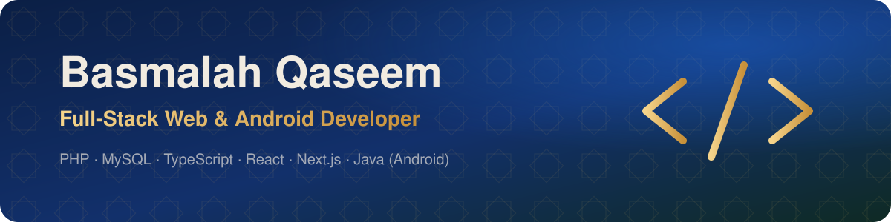

 

I'm **Basmalah**, a full-stack developer who builds **bilingual (Arabic / English) web and Android apps** with clean design and solid backends.

- 🔭 Building **Midad** — a free bilingual e-library with a curated shelf of Arabic classics
- 📱 Shipped **SmartQ** — queue management & appointment booking on the web and Android
- 🌱 Learning **Python** and going deeper into **TypeScript & React**
- 💬 Ask me about **PHP, MySQL, RTL layouts and Arabic UX**

<table>
<tr>
<td width="50%" valign="top">

### 📚 [Midad · مِداد](https://github.com/basmalah-Tarq/Midad)
A **bilingual e-library**: search 60,000+ free books, browse a hand-picked shelf of Arabic classics, download EPUB / PDF in one click and keep a personal reading list.

</td>
<td width="50%" valign="top">

### ⏱️ [SmartQ](https://github.com/basmalah-Tarq/SmartQ)
**Queue management & appointment booking** for clinics, banks and offices — website + Android app with live queue tickets, smart time suggestions and no double bookings.

</td>
</tr>
</table>

<table>
<tr>
<td align="center" width="140"><b>Backend</b></td>
<td>

</td>
</tr>
<tr>
<td align="center"><b>Frontend</b></td>
<td>

</td>
</tr>
<tr>
<td align="center"><b>Mobile</b></td>
<td>

</td>
</tr>
<tr>
<td align="center"><b>Tools</b></td>
<td>

</td>
</tr>
<tr>
<td align="center"><b>Learning</b></td>
<td>

</td>
</tr>
</table>

| | |
|---|---|
| 🌍 **Arabic-first UX** | Real RTL layouts and Arabic search that understands hamza and diacritics |
| 🎨 **Polished details** | Light / dark themes, responsive design, accessible components |
| 🔒 **Solid backends** | Prepared statements, transactions, role checks, safe uploads |
| 📦 **Ship it** | Projects that run on real hosting, with clear READMEs and screenshots |

أنا **بسملة**، مطوّرة ويب وتطبيقات أندرويد. بحب أبني مشاريع **بالعربي والإنجليزي** بتصميم مرتب وتجربة استخدام سهلة.

- 📚 **مِداد**: مكتبة إلكترونية فيها آلاف الكتب المجانية، ورف لروائع الأدب العربي.
- ⏱️ **SmartQ**: منصة ويب وتطبيق أندرويد لحجز الدور والمواعيد.

⭐ **If you like a project, a star means a lot!** · إذا عجبك مشروع، نجمة ⭐ بتفرق كثير!

